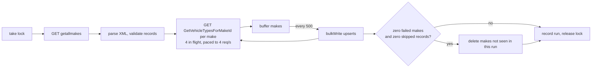

# bimm-backend

Pulls vehicle makes and their vehicle types from the NHTSA vPIC XML API, combines them into one JSON document per make, stores them in MongoDB and serves them through a single GraphQL endpoint.

Built with NestJS 12, TypeScript (ESM), Mongoose, Apollo and Vitest.

## Running it

Requirements: Docker with Compose. Node.js 24 only if you want to run it outside Docker.

```bash
docker compose up -d --build
docker compose run --rm api npm run ingest
```

The first command starts MongoDB and the API on http://localhost:3000. The second runs the ingestion once and exits. A full run makes about 12,400 requests to vPIC and takes around 50 minutes at the default pace (see [Ingestion](#ingestion) for why). The API serves whatever has been written so far, so you can query while it runs.

Then open http://localhost:3000/graphql for GraphiQL, or:

```bash
curl -s localhost:3000/graphql -H 'content-type: application/json' \
  -d '{"query":"{ make(makeId: 440) { makeName vehicleTypes { typeName } } }"}'
```

Health check: `GET /health` reports whether MongoDB is reachable.

### Without Docker

```bash
nvm use
npm install
docker compose up -d mongo   # or any MongoDB 8.2 on localhost:27017
npm run start:dev            # API with reload, pretty logs, writes schema.gql
npm run ingest:dev           # one ingestion run from source
```

### Build and checks

```bash
npm run build        # compiles to dist/
npm run start:prod   # runs dist/main.js
npm run ingest       # runs dist/ingest.js
npm run lint         # oxlint, type-aware
npm run format:check # prettier
npm run typecheck
npm test             # unit tests
npm run test:e2e     # integration tests against an in-memory MongoDB
npm run test:cov     # unit tests with coverage
```

The integration tests download a MongoDB 8.2.12 binary on first run (cached afterwards).

## Configuration

All configuration comes from environment variables, validated with Zod when the process starts. An invalid value stops the boot with a message listing every bad variable at once. Locally you can put overrides in `.env.<APP_ENV>` (see `.env.example`); real environment variables win over the file.

`APP_ENV` picks the environment and its defaults. It is separate from `NODE_ENV`: staging and production both run with `NODE_ENV=production`, so libraries behave the same in both.

| Variable | Default | Description |
|---|---|---|
| `APP_ENV` | `development` | `development`, `test`, `staging` or `production` |
| `PORT` | `3000` | HTTP port of the API |
| `LOG_LEVEL` | `debug` in development, `silent` in test, `info` otherwise | `fatal`, `error`, `warn`, `info`, `debug`, `trace` or `silent` |
| `LOG_PRETTY` | `true` in development, `false` otherwise | human-readable logs via `pino-pretty` (a dev dependency, so not available in the Docker image) |
| `MONGODB_URI` | `mongodb://localhost:27017/bimm` in development, required otherwise | MongoDB connection string |
| `GRAPHQL_PLAYGROUND` | `true` in development and staging, `false` otherwise | GraphiQL and introspection on `/graphql` |
| `VPIC_BASE_URL` | `https://vpic.nhtsa.dot.gov/api/vehicles` | vPIC API root |
| `VPIC_TIMEOUT_MS` | `10000` | timeout per request attempt |
| `VPIC_RETRY_ATTEMPTS` | `3` | attempts per request, including the first |
| `VPIC_REQUESTS_PER_SECOND` | `4` | pace of all request attempts to vPIC, retries included |
| `INGESTION_CONCURRENCY` | `4` | vehicle type requests in flight at once |
| `INGESTION_BATCH_SIZE` | `500` | makes written per MongoDB `bulkWrite` |
| `INGESTION_MAX_FAILURE_RATIO` | `0.1` | share of makes allowed to fail before the run aborts |
| `INGESTION_LOCK_TTL_MS` | `120000` | how long a crashed run's lock blocks the next run |

`docker-compose.yml` runs the production image with `APP_ENV=production` and `GRAPHQL_PLAYGROUND=true`, so GraphiQL is available while everything else behaves as in production.

## Ingestion

Ingestion is its own process, `src/ingest.ts`, started with `npm run ingest`. It runs once and exits: `0` when the run completed, `1` when it failed, was interrupted, or another run held the lock. Scheduling is left to whatever runs it (cron, a CronJob, CI).



1. Take the lock (one document in `locks`), so two runs never overlap. It is a lease: the running process extends it every `INGESTION_LOCK_TTL_MS / 3`, and a lock left by a crashed run expires on its own.
2. Fetch all makes, parse the XML and validate each record.
3. Fetch each make's vehicle types, with `INGESTION_CONCURRENCY` requests in flight and every attempt paced to `VPIC_REQUESTS_PER_SECOND`.
4. Write in batches with `bulkWrite` upserts keyed on `makeId`. Running ingestion twice gives the same documents.
5. If every make was fetched and written, delete makes that are no longer listed upstream.
6. Record the run in `ingestion_runs` and release the lock.

### Why it is slow on purpose

The first full run at 10 parallel requests got my machine's IP blocked after about 80 makes: every request, from any client, got a 403 for a long time afterwards. So every request attempt goes through a pacer (an interceptor on the HTTP client), and a 403 or 429 stops the run straight away instead of digging the hole deeper.

### Error handling

| Failure | What happens |
|---|---|
| `getallmakes` fails (network, timeout, bad XML), after retries | Run fails. Existing data is untouched. |
| Vehicle types for one make fail (network, timeout, bad XML, an invalid type record) | Logged with the `makeId`, counted as failed, and skipped: the make keeps its previous document, the next run tries again. A partial type list is never written. |
| vPIC answers 403 or 429 | Run aborts with a message pointing at `VPIC_REQUESTS_PER_SECOND`. A 403 aborts at once; a 429 is first retried by the HTTP client like any other retryable status. |
| More than `INGESTION_MAX_FAILURE_RATIO` of all makes fail | Run aborts. That many failures means vPIC is down. |
| A make record in `getallmakes` is invalid | Skipped and logged with its raw values. The run still completes but does not delete anything. |
| A batch write fails | Retried twice (after 1 s and 2 s). Safe, because writes are upserts. If it still fails, the run aborts; batches already written stay. |
| MongoDB rejects some documents in a batch | The rest of the batch is written (`ordered: false`); the rejected makes count as failed. |
| SIGINT or SIGTERM | No new requests start, the current batch is flushed, the run is recorded as `interrupted`, the lock is released, exit code `1`. |
| Another run holds the lock | Exits with code `1` without touching anything. |

HTTP timeouts and retries (3 attempts with jittered backoff on network errors, timeouts and 408/429/5xx) come from `@nestjs/http-client`. Its errors are converted into `VpicRequestError` at the client, so the rest of the code deals with one error type that names what failed: `failed to fetch vehicle types for make 440: timeout after 10000ms`.

The XML has a few quirks the parser and transformer handle, each covered by tests against responses saved from the API: a single record comes back as an object rather than a list, an empty result is `<Results />`, some names have trailing spaces, and one make is literally named `818`, which a default XML parser turns into a number.

## Data model

One document per make in the `makes` collection, with its vehicle types embedded. That is the shape the API returns, a read is a single query, and the largest type list is a handful of entries.

```ts
{
  makeId: number,          // unique index
  makeName: string,        // index, for prefix search
  vehicleTypes: [{ typeId: number, typeName: string }],
  lastIngestedAt: Date,    // start of the run that last wrote it
  createdAt: Date,
  updatedAt: Date
}
```

Indexes: `{ makeId: 1 }` unique, `{ makeName: 1 }`, `{ 'vehicleTypes.typeId': 1, makeId: 1 }`.

Ids are numbers everywhere (MongoDB, TypeScript, GraphQL `Int`). The reference JSON shows them as strings, but vPIC returns numbers, and numbers sort correctly for cursor pagination.

`ingestion_runs` keeps one document per run: `status` (`running`, `completed`, `failed`, `interrupted`), `startedAt`, `finishedAt`, counters (`makesFetched`, `makesWritten`, `makesFailed`, `makesDeleted`, `recordsSkipped`), `failedMakeIds` and the `error` that aborted it. `locks` holds at most one document, the ingestion lease.

## GraphQL API

`POST /graphql`. The schema is code-first; the generated SDL is committed as [`schema.gql`](schema.gql) and every type, field and argument has a description.

```graphql
type Query {
  makes(first: Int! = 50, after: String, filter: MakeFilterInput): MakeConnection!
  make(makeId: Int!): Make
}

type Make {
  makeId: Int!
  makeName: String!
  vehicleTypes: [VehicleType!]!
}

type VehicleType {
  typeId: Int!
  typeName: String!
}

input MakeFilterInput {
  namePrefix: String   # case-insensitive
  vehicleTypeId: Int
}
```

`makes` is a Relay-style connection (`edges { cursor node }`, `pageInfo { hasNextPage endCursor }`, `totalCount`) ordered by `makeId`. Pages are fetched with `makeId > cursor` on the unique index, so page 200 costs the same as page 1 and pages don't shift while ingestion writes. `first` is between 1 and 100. Invalid arguments (page size, an unknown cursor, an empty prefix) return an error with code `BAD_USER_INPUT`. Unexpected errors are logged with their stack and returned as a generic `INTERNAL_SERVER_ERROR` outside development.

### Example queries

Makes starting with "a" that build passenger cars (type 2), five per page:

```graphql
query Makes($after: String) {
  makes(first: 5, after: $after, filter: { namePrefix: "a", vehicleTypeId: 2 }) {
    totalCount
    edges {
      node {
        makeId
        makeName
        vehicleTypes {
          typeName
        }
      }
    }
    pageInfo {
      hasNextPage
      endCursor
    }
  }
}
```

For the next page, pass the previous `endCursor` as a variable: `{ "after": "<endCursor>" }`.

One make by id:

```graphql
{
  make(makeId: 440) {
    makeName
    vehicleTypes {
      typeId
      typeName
    }
  }
}
```

```json
{
  "data": {
    "make": {
      "makeName": "ASTON MARTIN",
      "vehicleTypes": [
        { "typeId": 2, "typeName": "Passenger Car" },
        { "typeId": 7, "typeName": "Multipurpose Passenger Vehicle (MPV)" }
      ]
    }
  }
}
```

## Logging

Both processes log JSON to stdout through Pino (`nestjs-pino`), with the same setup and level. Locally `LOG_PRETTY=true` makes them readable.

- Startup and shutdown: `api listening` with `{ appEnv, port, logLevel }`, `api shutting down` with the signal, `shutdown signal received, stopping ingestion`.
- API requests: one line per request from `pino-http` with a request id, method, URL, status and response time. `authorization` and `cookie` headers are redacted.
- GraphQL: unexpected errors at `error` with the stack and the field path.
- Ingestion: every line carries `runId`. `ingestion started`, `ingestion progress` after each batch, a `warn` for each skipped make or record with its id and error, and `ingestion finished` with the status, counters and `durationMs`.

Errors are logged under `err`, with type, message, stack and cause.

## Project structure

Conventional Nest feature modules, with one folder per role inside each module, so the layering the spec asks for shows in the tree:

- Domain: `entities/`, `contracts/` (`MakesReader`, `MakesWriter`), `errors/`, the transformer in `vpic/parsing/` and the `VpicClient` contract. No Nest, Mongoose or HTTP code.
- Application: `services/` (`MakesService`, `IngestionService`, `IngestionLockService`).
- Infrastructure: `repositories/`, `schemas/`, `HttpVpicClient`, the XML parser, and the config, database and logger modules in `core/`.
- Presentation: `resolvers/`, `dto/`, `models/`, the cursor in `pagination/`, `HealthController`.

```
src/
  main.ts, ingest.ts        two entry points
  app.module.ts             API: config, logger, database, GraphQL, makes, health
  ingestion-app.module.ts   ingestion: config, logger, database, ingestion
  core/                     config, logger, database, graphql: shared by both entry points
  health/                   GET /health
  makes/                    contracts/ entities/ services/ repositories/ resolvers/ pagination/ ...
  vpic/                     client/ (contract, HTTP client, pacer), parsing/ (XML parser, transformer)
  ingestion/                services/ (pipeline, lock), repositories/, concurrency/, entities/
test/
  fixtures/                 real vPIC responses
  support/                  fixture loader, fetch stub, Mongo setup
  *.e2e-spec.ts             integration tests
```

Services depend on abstract classes used as Nest injection tokens (`{ provide: MakesReader, useExisting: MongoMakesRepository }`). The API only gets `MakesReader` and ingestion only gets `MakesWriter`, so "the API never writes" is enforced by types, and unit tests swap in in-memory fakes without mocking libraries.

## Testing

- Unit tests (`src/**/*.spec.ts`): XML parsing and transformation against saved vPIC responses, the HTTP client with a stubbed `fetch` (retries, timeouts, 403 handling), the request pacer, the config schema, the ingestion pipeline's error policy with fakes, the lock heartbeat, pagination logic, the cursor and the GraphQL validation pipe.
- Integration tests (`test/*.e2e-spec.ts`): MongoDB 8.2 via `mongodb-memory-server` and a stubbed `fetch` serving the fixtures. They cover the repository, the lock under contention, and the whole path from ingestion to GraphQL responses, including a second run leaving identical documents.

Nothing in the test suites calls the real vPIC API.

## CI

GitHub Actions on pushes and pull requests to `main` (production) and `staging`: lint, format check, typecheck and build; unit tests with coverage and integration tests, with JUnit reports; then a Docker build tagged `bimm-backend:<production|staging>-<sha>`. Coverage, test reports and `dist/` are uploaded as artifacts. The image is built, not pushed, since there is no registry.

## Decisions and tradeoffs

- **Ingestion as a separate one-shot process.** A full run takes close to an hour, so it doesn't belong in a request or in the API process. Scheduling is left to the platform instead of building one in.
- **Upserts instead of a staging collection.** Writing to a temporary collection and renaming it would make each run all-or-nothing, but every write here is an idempotent upsert, so a half-finished run still leaves valid data and the next run fills the gaps.
- **Failed makes keep their old data.** Writing an empty type list for a make whose request failed would replace a known-good answer with a wrong one.
- **Deleting only after a clean run.** A make missing from a run that had failures might just be a failure, so nothing is deleted unless every make was seen.
- **Pacing over concurrency.** Concurrency alone got the IP blocked. The pace is the real limit; concurrency only bounds sockets and memory.
- **Numeric ids.** The reference JSON uses strings, vPIC uses numbers, and cursor pagination needs numeric order.
- **Relay connection instead of offset pagination.** Offsets get slower with depth in MongoDB and shift while ingestion writes.
- **`@nestjs/http-client` at 0.0.2.** It is the official Nest client on native `fetch` with retries and typed errors built in, but very new, so the version is pinned and only `HttpVpicClient` imports it.
- **ESM, Vitest and oxlint.** That is what `nest new` generates for Nest 12, and the HTTP client ships as ESM only.

## What I'd do with more time

- Fetch only what changed. vPIC has no change feed, but makes could be refreshed on a rotating schedule instead of all 12,400 every run.
- Expose the latest ingestion run (status, finish time) in GraphQL so clients can tell how fresh the data is.
- Push the image to a registry and deploy staging and production from CI.
- Metrics (requests, failures, run duration) alongside the logs.
